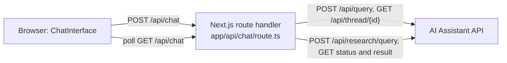

# AI Assistant Frontend

A Next.js chat interface for the [AI Assistant API](https://github.com/dpelezo/AI-Assistant-API): ask a question in **Search** mode for a quick answer backed by web search, or in **Deep research** mode for a multi-step research report.

- **Live demo:** [ai-assistant-frontend-beta.vercel.app](https://ai-assistant-frontend-beta.vercel.app)
- **Backend:** [AI-Assistant-API](https://github.com/dpelezo/AI-Assistant-API) (FastAPI, LangGraph, Claude, Exa)

## How it works



1. The browser only talks to this app's own route, `app/api/chat/route.ts`. That route calls the backend, so the backend URL stays in one place.
2. **Search mode:** the route sends the question to `POST /api/query`. The page then polls for the reply through `GET /api/chat?thread_id=...`.
3. **Deep research mode:** the route starts `POST /api/research/query` (3 iterations). The page polls `GET /api/chat?research_id=...` until the report is ready.
4. Replies are rendered as Markdown (headings, lists, links, tables). If anything fails, the visitor sees a short notice in a red bubble; details stay in the server logs.

## Tech stack

- Next.js 15 (App Router) and React 19, TypeScript
- Tailwind CSS 4, with shadcn/ui-style components built on Radix UI
- react-markdown with GitHub-flavored Markdown for replies
- Lucide icons

## Known limitations

- **No attachments.** The attachment (+) button in the message box does nothing yet.
- **No memory in Search mode.** Each Search question starts a new thread, so follow-up questions do not see earlier answers.
- **No tests, linting or CI yet.**

## Run it locally

Prerequisites: Node.js 18.18 or newer, and the [backend](https://github.com/dpelezo/AI-Assistant-API) running locally or deployed.

```bash
git clone https://github.com/dpelezo/AI_assistant_frontend.git
cd AI_assistant_frontend
npm install
echo "NEXT_PUBLIC_API_URL=http://localhost:8000" > .env.local
npm run dev    # http://localhost:3000
```

| Variable | Purpose |
|----------|---------|
| `NEXT_PUBLIC_API_URL` | Base URL of the AI Assistant API, without `/api`. If it is unset, the app uses the deployed backend. |

Other scripts: `npm run build` and `npm run start`. ESLint is not configured yet, so `npm run lint` asks you to set it up.

## Deploy

The live demo runs on Vercel. To deploy your own copy, import the repository in Vercel, set `NEXT_PUBLIC_API_URL` to your backend URL, and deploy. On the backend, add your front-end URL to `BACKEND_CORS_ORIGINS`.

## Project structure

```
app/
├── api/chat/route.ts       # proxies chat and research requests to the backend
├── layout.tsx              # header and page shell
├── page.tsx                # renders ChatInterface
└── globals.css
components/
├── chat-interface.tsx      # state, sending and polling for replies
├── chat-message.tsx        # one message bubble
├── markdown.tsx            # styled Markdown rendering for replies
├── message-input.tsx       # text box and Search / Deep research toggle
└── ui/                     # avatar, button, card, textarea
lib/
├── types.ts                # message and chat state types
└── utils.ts                # className helper
public/                     # logo and icons
```

## License

[MIT](LICENSE) © 2025 Domingos Pelezo
